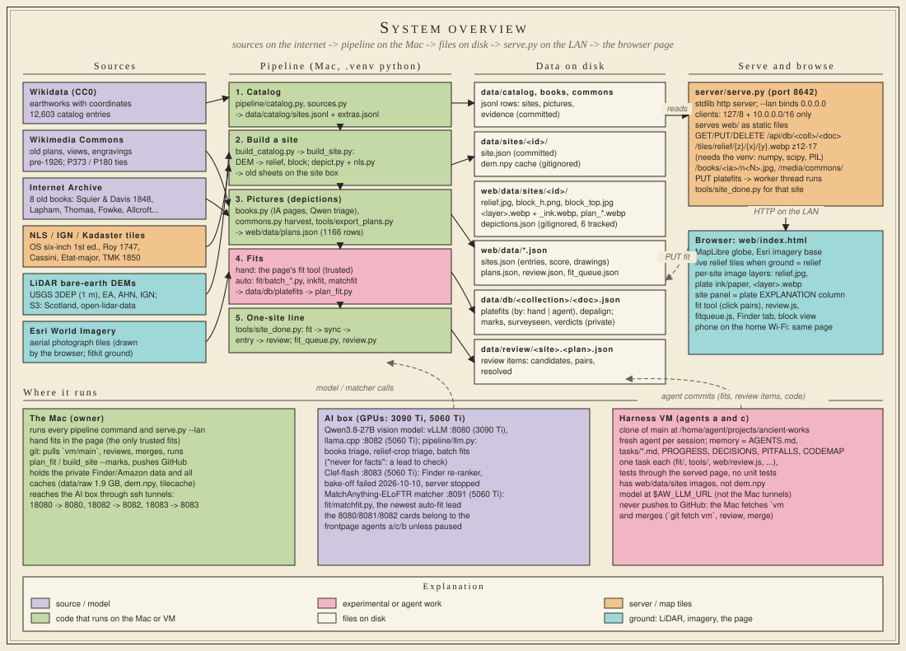
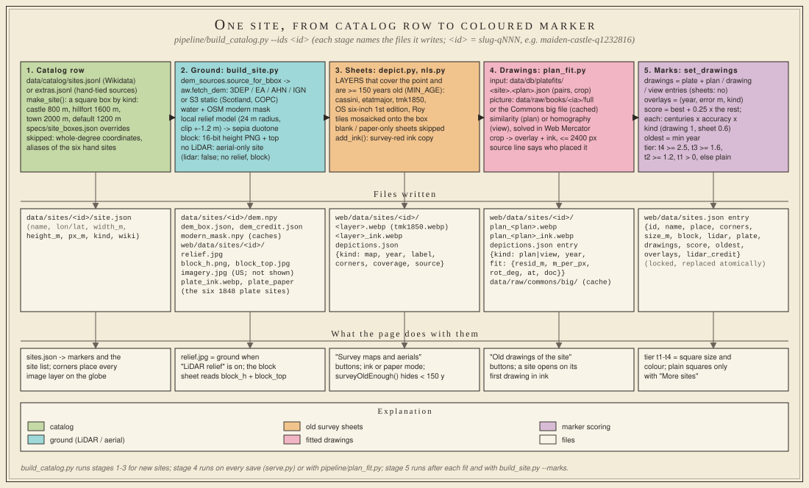
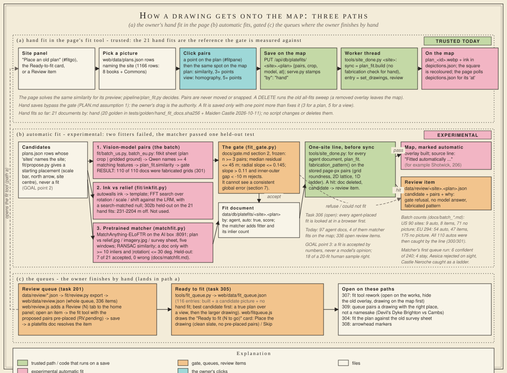
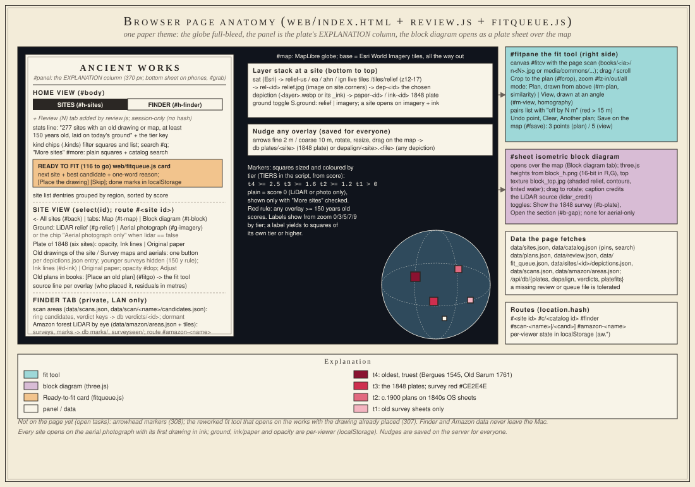
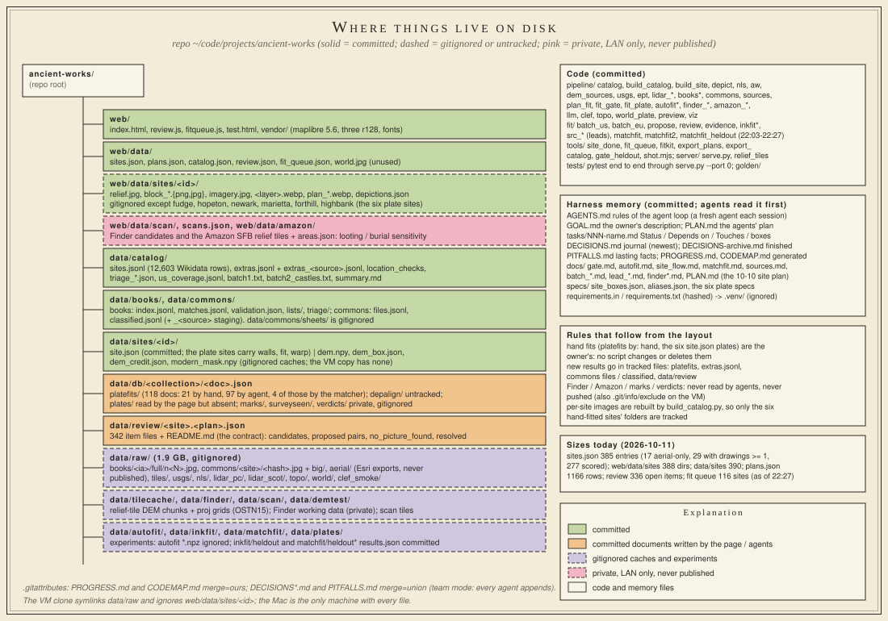
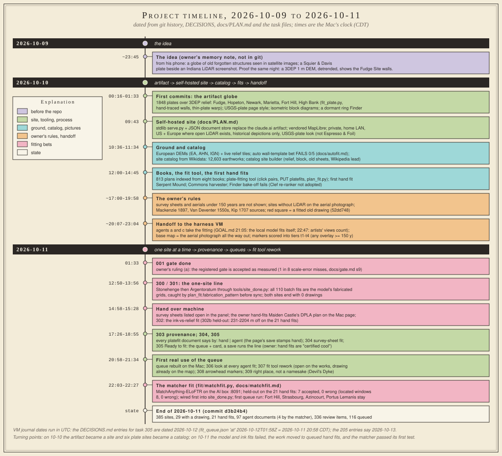

# How Ancient Works works

Ancient Works is a private, self-hosted globe of old earthworks, castles, Roman forts, walled towns and lost
gardens. For each built site the page shows today's ground (a LiDAR local-relief image where open LiDAR exists,
the Esri aerial photograph everywhere) and, on top of it, old pictures of the place: survey plates, antiquarian
plans, bird's-eye views, and the georeferenced survey sheets of 150 or more years ago. What makes a site worth
opening is an old drawing of the structure itself fitted onto today's ground, so you see how little has changed.
Everything runs from `~/code/projects/ancient-works` on the owner's Mac: a Python pipeline builds the per-site
files, `server/serve.py` serves them on the home LAN, and a single-file MapLibre page draws them.

The project is three days old and has been through three shapes: a claude.ai artifact with six 1848 plates
(2026-10-10 00:16), a self-hosted site with a Wikidata catalog and a point-pair fit tool (the rest of 2026-10-10),
and a handoff to two harness agents on a VM whose automatic fits all failed their tests, so that on 2026-10-11 the
work settled on the owner's hand fits, queued one site at a time (`tools/site_done.py`, `tools/fit_queue.py`), with
a pretrained image matcher (`fit/matchfit.py`, 22:03) as the first automatic fitter to pass a held-out test.
This document explains the system as the code is at commit d3b24b4 (2026-10-11 22:27): diagrams first, prose
second, a glossary, how to run it, and where the docs and the code disagree. Sources: AGENTS.md, GOAL.md, PLAN.md,
docs/PLAN.md, CODEMAP.md, docs/site_flow.md, docs/sources.md, docs/gate.md, docs/autofit.md, docs/matchfit.md, the
module headers, and the data on disk.

## 1. System overview



Six kinds of source feed a five-stage pipeline: Wikidata gives the catalog (`pipeline/catalog.py`, 12,603 rows),
Commons and the Internet Archive give the pictures (`pipeline/commons.py`, `pipeline/books.py`, `tools/export_plans.py`
-> `web/data/plans.json`), NLS/IGN/Kadaster tiles give the old survey sheets (`pipeline/depict.py`, `pipeline/nls.py`),
the national LiDAR services and S3 mirrors give the DEMs (`pipeline/dem_sources.py`, `pipeline/aw.py`), and Esri
World Imagery is the aerial ground both in the browser and in `tools/fitkit.py`. The pipeline writes plain files:
per-site images under `web/data/sites/<id>/`, index files under `web/data/`, fit documents under `data/db/`, review
items under `data/review/`. `server/serve.py` serves `web/` plus a JSON document store (`/api/db/<coll>/<doc>`),
live relief tiles (`/tiles/relief/{z}/{x}/{y}.webp`, z 12-17) and the old book pages. A PUT to `platefits` wakes a
worker thread that runs the one-site line for that site.

Three machines: the Mac runs everything above and is the only machine with every file; the AI box's GPUs serve the
Qwen vision model (`pipeline/llm.py`, tunnelled ports 18080/18082), the stopped Clef-flash re-ranker (`:8083`) and
the new MatchAnything matcher (`:8091`, `fit/matchfit.py`); the harness VM runs agents a and c on `tasks/*.md`,
committing to a `vm` remote that the Mac fetches, reviews and merges (never the other way: the VM never pushes).

## 2. One site's build



`pipeline/build_catalog.py --ids <id>` turns a catalog row into a site: `make_site` picks a square box by kind
(castle 800 m, hillfort 1600 m, town 2000 m) and writes `data/sites/<id>/site.json`; `build_site.py` fetches the DEM
(`dem.npy`, cached and gitignored), renders the local relief model as `relief.jpg`, the block diagram as
`block_h.png` + `block_top.jpg`, and writes the `sites.json` entry; `depict.py` and `nls.py` mosaic the old sheets
that cover the point and are at least 150 years old into `<layer>.webp` + `<layer>_ink.webp` and list them in
`depictions.json`. Where no LiDAR source has data the site is built on the aerial photograph only (`"lidar": false`,
no relief, no block), but only if an old map covers it. Fitted drawings arrive later through `pipeline/plan_fit.py`
(`plan_<plan>.webp` + ink, a `kind: plan|view` entry with its fit record), and `build_site.set_drawings` refreshes
the marker fields `drawings`, `score`, `oldest`, `overlays` that the page turns into a tier.

## 3. How a drawing gets onto the map



Path (a), the owner's hand fit, is the only trusted path today. In the site panel, "Place an old plan" (or the
Ready-to-fit card, or a Review item) opens the fit tool: pick a `plans.json` row, click a point on the plan, then
the same spot on the map, repeat; a plan needs 3 points to save, a perspective view 5. Save PUTs
`platefits/<site>.<plan>`; `serve.py` stamps `"by": "hand"` and runs `tools/site_done.py` in a worker thread, which
builds the overlay, refreshes the entry and resolves the review item; the page polls `depictions.json` until the
overlay with the saved `at` appears. The 21 hand documents (20 pinned by `tests/golden/hand_fit_docs.sha256` plus
Maiden Castle) are the reference and nothing may change them.

Path (b) is experimental. Two of its three fitters failed: the batch (`fit/batch_us.py`, `batch_eu.py`) asked the
Qwen vision model for matching features on a fitkit sheet, and all 110 fits it wrote were the model's fabricated
grids (tasks 300/301); the ink fit (`fit/inkfit.py`) searched plate ink against the relief and landed 231-2204 m
off on the held-out hand fits (302b). The third, the matcher (`fit/matchfit.py`), asks MatchAnything-ELoFTR on the
AI box for real point matches between the plan and the relief, the aerial or a survey sheet, and writes a document
only with 10+ inliers and a rotation within 30 degrees; on the 21 hand fits it accepted 7 with none wrong
(docs/matchfit.md; 8 with located windows), and `tools/site_done.py` now runs it first. Its first queue run put
Fort Hill, Strasbourg, Azincourt and Portus Lemanis on the map; Aesica was rejected on sight. Every automatic
document goes through the gate (`pipeline/fit_gate.py`, docs/gate.md section 2) and then, in the one-site line,
through `plan_fit.fabrication_pattern`; a hit deletes the document and sends the candidate to the site's review
item (Castle Neroche's matcher points were caught this way). The gate cannot see a consistent global error (section
7), which is why GOAL point 3 keeps a human sample of 20 automatic fits and task 306 wants every agent fit looked at.

Path (c) is the two queues the owner works through: the Review queue (`data/review/`, exported to
`web/data/review.json`, 336 open items, shown by `web/review.js` with the proposed pairs pre-placed) and Ready to
fit (`tools/fit_queue.py` -> `web/data/fit_queue.json`, 116 built sites with a candidate and no hand fit, shown as a
card by `web/fitqueue.js` with "Place the drawing" and "Skip"). Both end in path (a).

## 4. The browser page



`web/index.html` is one file: a MapLibre globe (`#map`) with the Esri aerial as base all the way out, the national
relief tiles (`relief-us/ea/ahn/ign`) when the ground is set to relief, and per-site image layers placed by the
site's `corners` (`rel-<id>`, `dep-<id>`, `paper-<id>`/`ink-<id>`). Markers are squares sized and coloured by tier
from `score` (t4 >= 2.5, t3 >= 1.6, t2 >= 1.2, t1 > 0); the red rule since 2026-10-10 counts any overlay 150 or more
years old, and the plain squares of sites with only LiDAR or the photograph show only with "More sites". The left
panel (`#panel`, the plate's EXPLANATION column; a bottom sheet on phones) has a home view with Sites and Finder
tabs (`review.js` adds Review, `fitqueue.js` adds the Ready-to-fit card) and a site view: Map | Block diagram tabs,
Ground (LiDAR relief | Aerial photograph), the 1848 plate group on the six plate sites, "Old drawings of the site"
and "Survey maps and aerials" buttons from `depictions.json` (younger surveys hidden), Ink lines | Original paper,
opacity, a nudge block whose result is saved for everyone in `db plates/` or `depalign/`, and "Place an old plan".
The fit tool lives in `#fitpane` on the right; the block diagram (`#sheet`, three.js) opens over the map. Routes:
`#<site id>`, `#c/<catalog id>`, `#finder`, `#scan-<name>`, `#amazon-<name>`.

## 5. Where things live on disk



Committed: the code, the harness memory files, `web/` and its index JSONs, the catalog, book and Commons rows,
every `data/sites/<id>/site.json`, `data/db/platefits/` (118 documents: 21 hand, 97 agent, 4 of those by the
matcher), `data/review/` and the held-out results under `data/inkfit/` and `data/matchfit/`. Gitignored:
`web/data/sites/<id>/` except the six plate sites, every DEM and image cache (`data/raw/` at 1.9 GB, `dem.npy`,
`data/tilecache/`), `.venv/`, the autofit `.npz` outputs, and the private Finder and Amazon data (`web/data/scan/`,
`web/data/amazon/`, `data/finder/`, `data/db/{marks,surveyseen,verdicts}/`), which never leave the Mac. The Amazon SFB
relief tiles are served on the LAN only. Untracked today: `data/db/depalign/` (the page's nudge documents).

## 6. Timeline



The idea on 2026-10-09 (the owner's memory note); the artifact-era globe at 00:16 on 2026-10-10 and the self-hosted
site by 09:43; ground, catalog, books and the fit tool by midday; the owner's rules (150-year survey rule, aerial-only
sites, red square = a fitted drawing) in the evening; the handoff to the VM agents and GOAL.md's "the local model
fits itself" at 21:05. On 2026-10-11: the gate accepted as measured (01:33), the one-site line and the discovery that
all 110 batch fits were fabricated (12:50-13:56), the ink fit's failed held-out table, provenance stamps (303), the
Ready-to-fit queue (305), the owner's first real use and the resulting rework tasks 306-309, and at 22:03-22:27
the matcher: held-out 7 of 21 with none wrong, wired into the line, four sites placed.

## Glossary

- **site**: a built place with an entry in `web/data/sites.json` and a `web/data/sites/<id>/` folder; id = slug-qNNN.
- **depiction**: one overlay listed in a site's `depictions.json`: kind `map`, `aerial`, `topo` (surveys) or `plan`,
  `drawing`, `view` (drawings of the structure); only drawings count towards `drawings`.
- **plate**: one of the six hand-traced 1848 Squier & Davis survey plates (`site.json` `plate`, `plate_ink.webp`),
  fitted by `pipeline/fit_plate.py` against the relief; also, loosely, any scanned book page with a plan.
- **plan**: a drawing made from above (fitted with a similarity); a row of `web/data/plans.json` (1166 rows from 8
  books and Commons), keyed by `id` such as `earthworkenglan01allcgoog_n0597_1` or `c_<hash>`.
- **view**: a bird's-eye or perspective drawing, fitted with a homography (4 points fix it, a 5th checks it).
- **sheet**: a georeferenced survey map series mosaicked onto the site box (OS six-inch, Roy, Cassini, Etat-major,
  TMK); background, never a drawing; hidden when younger than 150 years. Also: the fitkit contact sheet.
- **ink mode**: the survey-red (`#CE2E4E`) ink-only version of an overlay (`*_ink.webp`, `depict.add_ink`,
  `build_site.plate_ink`); the page opens every site in ink.
- **LRM / relief**: local relief model, the DEM minus a smoothed copy (24 m radius, clipped to +-1.2 m), rendered
  as a sepia duotone `relief.jpg`; the live tile layer is the same model per tile.
- **block**: the isometric block diagram (`block_h.png` 16-bit heights, `block_top.jpg` texture) drawn by three.js.
- **fit**: a placement of a picture on the ground; stored as a platefit document `data/db/platefits/<site>.<plan>.json`
  with `pairs`, `crop`, `model` (similarity | homography), `at`, `by` (hand | agent), and for the batch `auto`, `score`.
- **pair**: one anchor `[u, v, lon, lat]`: page pixel on the picture to a ground point.
- **gate**: `pipeline/fit_gate.py`, the frozen numerical accept/reject rule of docs/gate.md section 2 (median residual
  <= 45 m, radial-slope clauses), validated once on held-out hand fits; it scores automatic fits only.
- **review queue**: `data/review/<site>.<plan>.json` items (candidates, proposed pairs, `no_picture_found`,
  `resolved`) exported to `web/data/review.json`; a saved platefit document resolves an item.
- **Ready to fit**: `web/data/fit_queue.json`, built sites with a candidate and no hand fit, best candidate first.
- **tier / score**: `build_site.score`: per overlay centuries old x accuracy x kind (drawing 1, sheet 0.6); the site
  takes its best overlay plus a quarter of the rest; the page maps the score to t1-t4 marker sizes and colours.
- **catalog**: `data/catalog/sites.jsonl` (Wikidata, CC0) plus `extras.jsonl` (sites tied by hand from Mackenzie,
  Van Deventer, Kip, the artists' views); `web/data/catalog.json` is its compact copy for pins and search.
- **extras**: the hand-tied rows outside Wikidata's reach, with `aerial_ok` for towns and gardens without LiDAR.
- **one-site line**: `tools/site_done.py <id>`: fit (uncovered candidates only) -> sync -> entry -> review.
- **fitkit**: `tools/fitkit.py`, the gridded plan-beside-ground sheet an agent reads to place pairs by hand.

## Run it

```
cd ~/code/projects/ancient-works
.venv/bin/python server/serve.py --lan        # port 8642; --lan = home network (127/8 + 10.0.0.0/16 allowed)
# http://127.0.0.1:8642/  or  http://<Mac LAN IP>:8642/ from a phone on the home Wi-Fi
.venv/bin/python pipeline/build_catalog.py --ids <id>      # build a site (relief, block, old sheets)
.venv/bin/python tools/site_done.py <id>                   # take one site all the way to the map
.venv/bin/python tools/fit_queue.py                        # regenerate web/data/fit_queue.json
.venv/bin/python pipeline/plan_fit.py                      # rebuild every fit overlay (the DELETE sweep)
.venv/bin/python pipeline/build_site.py --marks            # refresh drawings/score/oldest/overlays for all sites
python3 -m pytest -q                                       # end-to-end tests against a temp copy of the tree
```

The venv matters: the system `python3` still serves the page, but relief tiles need numpy/scipy/PIL and answer
404 without them. Restart `serve.py` after editing `pipeline/plan_fit.py` (no module reload). Agents on the VM
reach the model at `$AW_LLM_URL`; on the Mac `pipeline/llm.py` expects the ssh tunnel `18080 -> aibox:8080`.

## Doc vs code

Dated snapshot, 2026-10-10/11 (this document was written against commit d3b24b4, 2026-10-11 22:27): the bullets
below were verified against the tree at that date and are kept as written - their file names and counts are
point-in-time, and several have moved since (`fit/merge.py` and `fit/cover.py` exist now, and the queue and item
sizes changed again). For current facts the docs of record are docs/site_flow.md (the one-site line and the
queues), docs/matchfit.md (the matcher, the only automatic fitter) and docs/gate.md (the frozen acceptance rule).
The Qwen bullet is kept current instead, to the post-retirement division (239, 2026-10-13).

- GOAL.md and PLAN.md say "25 of 384 built sites" and "19 of them from 20 documents"; `web/data/sites.json` has 385
  entries, 29 with `drawings >= 1`, and `data/db/platefits/` has 21 `by: hand` and 97 `by: agent` documents.
  `web/data/sites/` has 388 folders and `data/sites/` 390 (built but dropped or unlisted sites).
- AGENTS.md and GOAL.md name the VM's model endpoint `$LLM_URL`; `pipeline/llm.py` reads `AW_LLM_URL` (PLAN.md agrees
  with the code).
- docs/PLAN.md says the Qwen servers are "NOT used by this project" and classification runs on Clef-flash; the code
  uses Qwen through `pipeline/llm.py` for the book pipeline's find and triage (`books.py`, `catalog_triage.py`) and
  the cover's classification phase (212a's one-off `fit/cover_qwen8080.py` on the VM's own vLLM, answering Clef's
  questions, since Clef-flash is not running anywhere - its 5060 Ti now serves the matcher). The batch modules'
  vision-model fitting pass is retired (239, 2026-10-13): the local Qwen models never place a drawing and never
  write point pairs or coordinates - they find, classify and tie pictures and write code - and the pretrained
  matcher (`fit/matchfit.py`) is the only automatic fitter, run first in the one-site line (`tools/site_done.py`).
  Clef was stopped after the Finder bake-off failed on 2026-10-10.
- docs/PLAN.md phase 1 plans "USGS imagery tiles in the US"; the page draws Esri World Imagery everywhere, and the
  `imagery.jpg` that `build_site.py` saves is not displayed (docs/sources.md section 4 says so too).
- PLAN.md's module map lists `fit/merge.py` (211) and `fit/cover.py` (212) and makes 212 the one page-facing sync;
  neither file exists, and since task 300 the sync is per site in `tools/site_done.py` and on every page save in
  `server/serve.py`.
- docs/site_flow.md's step-by-step list (step 1 "fit") and CODEMAP.md predate the matcher: the line now runs
  `fit/matchfit.py` before the batch model (d3b24b4, 22:27), described only in site_flow.md's last section and
  docs/matchfit.md. The working tree still carries uncommitted matcher work (`fit/matchfit_heldout.py`, Fort Hill's
  `depictions.json` and plan overlay, `data/db/depalign/`).
- The page's home text says survey plates are "fitted by machine ... until the drawn walls sit on the highest
  ridges"; that describes only the six 1848 plates (`fit_plate.py`). Every other overlay is a point-pair fit.
- The fit tool's text says the plans "come from eight books of 1848 to 1914"; `plans.json` also holds the Commons rows.
- The page reads a `plates` collection for 1848-plate nudges; `data/db/plates/` does not exist on disk today
  (harmless: the store answers an empty list).
- docs/site_flow.md counts 117 queue entries and "340 open of 341 items"; today's files hold 116 entries and 336
  items (the queue was rebuilt on the Mac at 20:58, the matcher resolved four items at 22:27).
- The VM's journal dates run in UTC: DECISIONS.md entries for task 305 are dated 2026-10-12 and the 205 entries
  2026-10-13, while the Mac's last commit is 2026-10-11 21:34 CDT.
